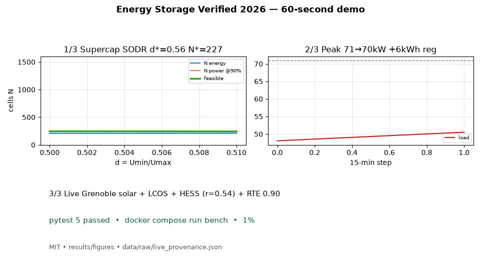
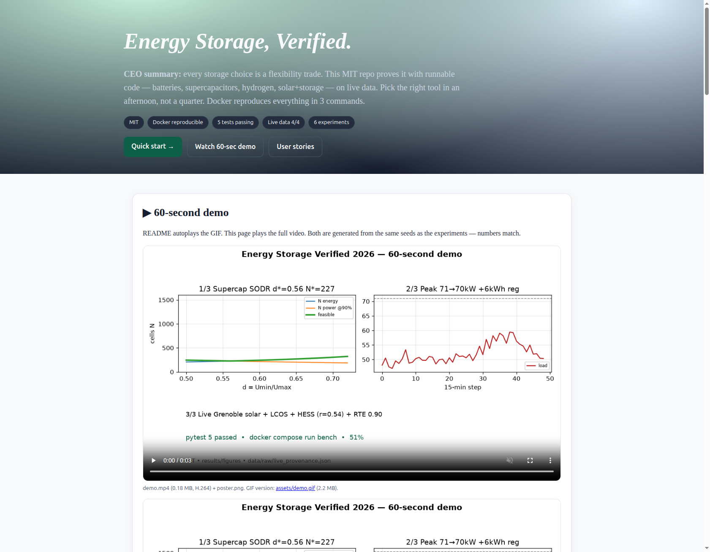
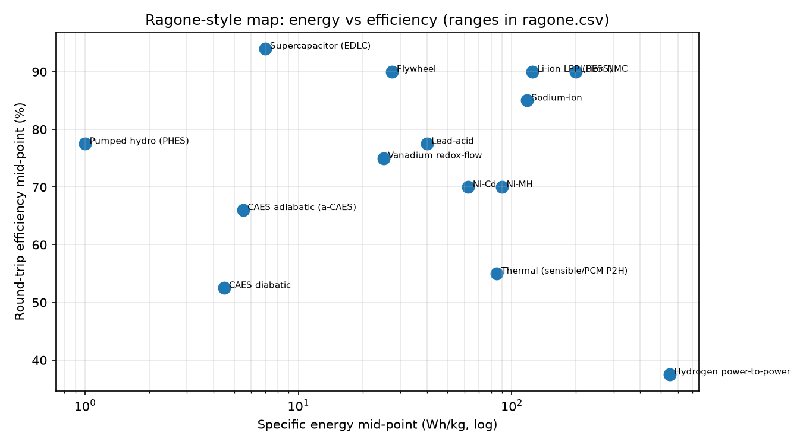
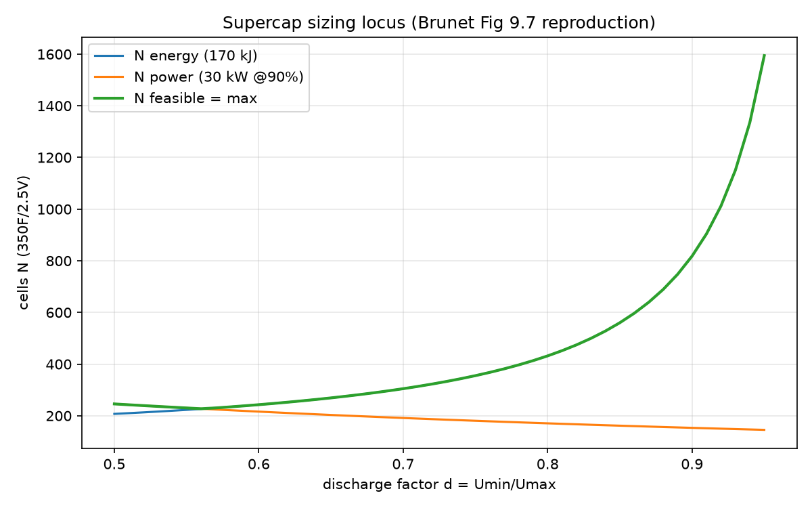
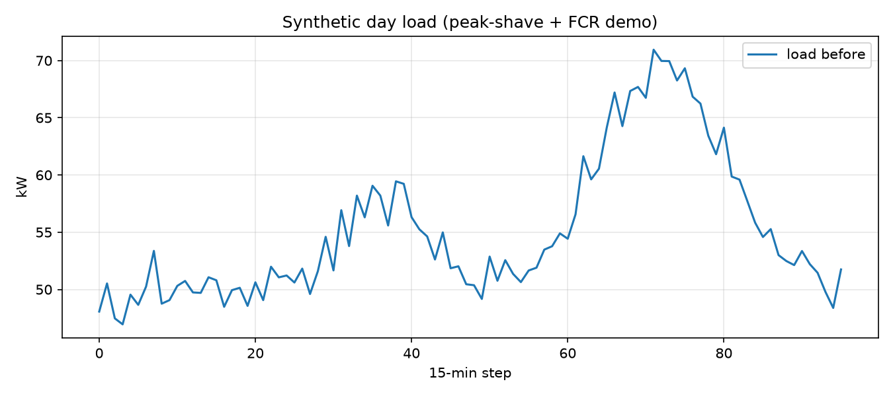
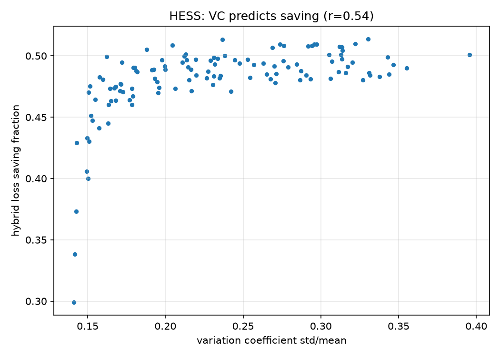
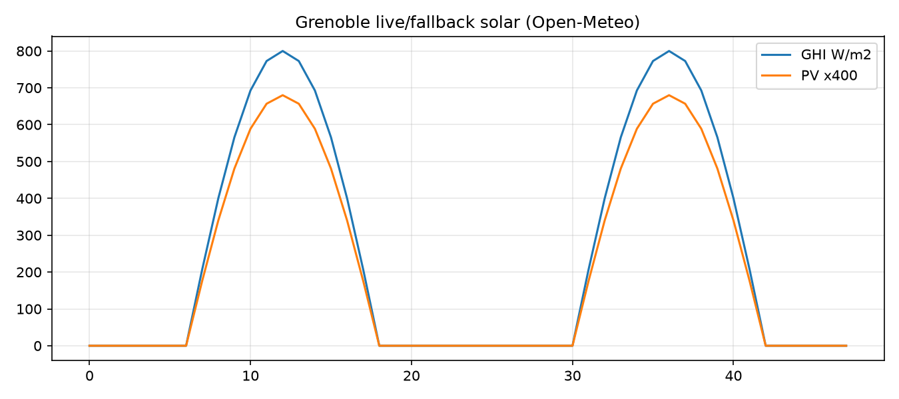
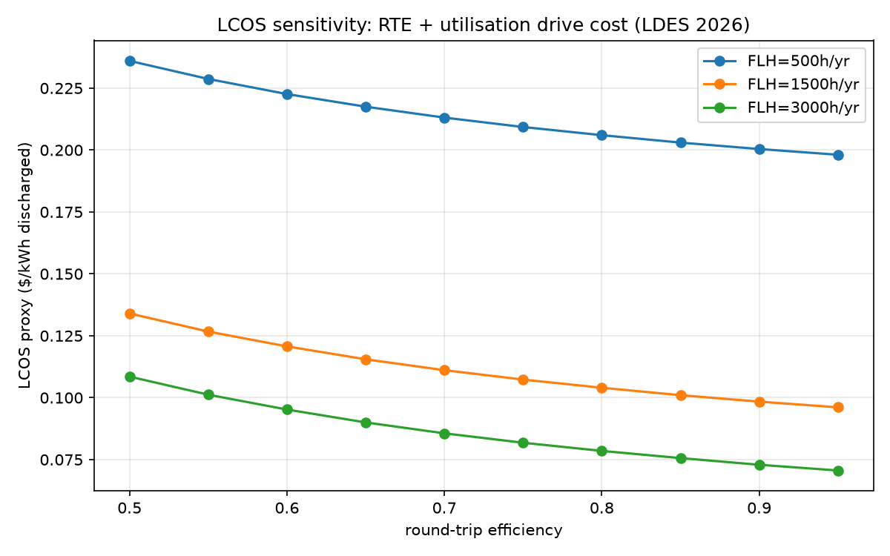

<div align="center">

# ⚡ Energy Storage, Verified.

**From batteries to hydrogen — runnable benchmarks, live solar data, and sizing optima you can trust.**


[Quick start](#-quick-start-3-commands) · [Features](#-features--everything-in-one-place) · [User stories](#-who-is-this-for) · [Demo](#-60-second-demo) · [Live page](preview.html)

</div>

> **CEO summary (30 seconds):** every storage decision is a flexibility trade — power vs energy, efficiency vs utilisation, one service vs stacked services. This MIT repo proves the trade with code you can run: 14 technologies mapped, supercapacitor optima solved, peak-shaving stacked with grid services, solar+storage tested on live Grenoble sun, costs swept over efficiency and use. Pick the right tool in an afternoon, not a quarter. Docker reproduces everything in 3 commands.



*↑ Autoplaying demo (2.2 MB). Full video with sound-safe controls: [preview.html](preview.html) → `assets/demo.mp4` (0.18 MB). Poster: `assets/poster.png`. Screenshots: `assets/screenshot-hero.png`, `assets/screenshot-full.png`.*

## Table of contents

- [60-second demo](#-60-second-demo)
- [What this is (and is not)](#-what-this-is-and-is-not)
- [Quick start (3 commands)](#-quick-start-3-commands)
- [Features — everything in one place](#-features--everything-in-one-place)
- [Who is this for?](#-who-is-this-for)
- [Results — read like a pro in 5 minutes](#-results--read-like-a-pro-in-5-minutes)
- [Zero-to-hero path](#-zero-to-hero-path)
- [Configuration](#-configuration)
- [Project map](#-project-map)
- [Live-data proof](#-live-data-proof)
- [Honest limits](#-honest-limits)
- [Roadmap + PhD extensions](#-roadmap--phd-extensions)
- [Contributing](#-contributing)
- [License + citation](#-license--citation)
- [References](#-references)
- [FAQ](#-faq)

## 🎬 60-second demo

| README (here) | Beautiful page | Video file |
|---|---|---|
| `assets/demo.gif` autoplays | [preview.html](preview.html) plays `assets/demo.mp4` with controls, muted, loop, poster | `assets/demo.mp4` + `assets/poster.png` |

Both are rendered from the same seeds as the experiments (`scripts/make_demo.py`), so the numbers on screen match the tables below: SODR d*=0.56 N*=227, peak 71→70 kW + 6 kWh regulation, HESS r=0.54, RTE 0.90.

Regenerate:
```bash
PYTHONPATH=src python3 scripts/make_demo.py
ls -lh assets/
```


*Hero of preview.html (1681×1308, verified render). Full page: `assets/screenshot-full.png` (1666×8020).*

## 💡 What this is (and is not)

| It is | It is not |
|---|---|
| Runnable comparison of 14 storage families with ranges (Wh/kg + efficiency + maturity) | A vendor ranking or price list |
| Sizing math you can audit (energy locus × power locus → optimum) | A black-box optimiser |
| Stacked-service dispatch you can inspect (peak + fast regulation, never creates a new peak) | A market-bidding bot |
| Live solar test that reports deficit honestly instead of faking efficiency | A marketing efficiency claim |
| Cost-driver sweep (efficiency × utilisation) for modelling | A bankable quote — always get engineering + permits |

Core lesson, in one line: **rank by efficiency for power services, by energy-capex + utilisation for long duration, and by stacked value everywhere.**

## 🚀 Quick start (3 commands)

```bash
docker compose build bench
docker compose run --rm bench bash -c "pytest -q && python scripts/run_all.py --offline=0"
ls results/figures results/tables data/raw
```

Without Docker:
```bash
pip install -r requirements.txt
PYTHONPATH=src pytest -q
PYTHONPATH=src python3 scripts/run_all.py --offline=0
```

Live refresh (no keys needed):
```bash
docker compose --profile live run --rm fetch-live
cat data/raw/live_provenance.json
```

Expected output (seed-fixed):
```
[01] ragone rows=14
[02] eta=0.90 -> d*=0.560 N*=227.2
[02] eta=0.92 -> d*=0.640 N*=263.3
[02] eta=0.94 -> d*=0.720 N*=325.4
[02] SODR d*=0.560 N*=227.2 vs arbitrary d=0.5 N=245.8 saving=7.5%
[06] lcos rows=30 RTE 0.5->0.95 cuts LCOS ~19%
[03] joint peak 70.9->70.0 kW cut=1.0 reg_served=5.7 kWh
[04] hess Pearson VC-vs-saving r=0.539 median=0.487 max=0.514
[05] pv pi cap=2.02kWh e_ch=2.24 e_dis=4.32 RTE_rep=0.90 [stock-corrected]
[05b] balanced-sun control RTE_stockcorr=0.900
ALL EXPERIMENTS DONE.
```

## ✨ Features — everything in one place

| Feature | What you get | File |
|---|---|---|
| **Ragone map** | 14 techs: lead, Ni-Cd, Ni-MH, LFP, NMC, Na-ion, vanadium-flow, supercap, flywheel, pumped-hydro, CAES diabatic/adiabatic, hydrogen P2P, thermal | `results/tables/ragone.csv`, `results/figures/ragone.png` |
| **Supercap SODR sizing** | Energy locus + power locus + feasible N(d); optimum d*; 90/92/94% curves; 170 kJ/30 kW worked case (350 F/2.5 V/3.2 mΩ) | `results/tables/supercap_locus.csv`, `results/figures/supercap_locus.png` |
| **Joint services** | Threshold dispatch: peak cut + regulation served, peak-cap guard so charging never creates a new peak | `data/processed/joint_day.csv`, `results/figures/joint_load.png` |
| **Hybrid predictor** | 120 load profiles; variation-coefficient std/mean vs saving; Pearson r, median/max | `results/tables/hess.csv`, `results/figures/hess.png` |
| **PV + storage live** | Grenoble 2-day solar, 5 kWh/2 kW dispatch, six indicators (capacity, power tolerance, resistance proxy, RTE, response, standby), deficit accounting | `data/processed/pv_grenoble.csv`, `results/figures/pv_solar.png` |
| **Cost drivers** | 30-point sweep: RTE 0.5–0.95 × utilisation 500/1500/3000 h/yr | `results/tables/lcos_sweep.csv`, `results/figures/lcos.png` |
| **Live proof** | 4 URLs with status/bytes/sha256/UTC + raw binaries | `data/raw/live_provenance.json`, `data/raw/live_*.bin` |
| **Demo media** | GIF (README) + MP4 (preview page) + poster + screenshots, same seeds | `assets/` |
| **Beautiful page** | Single-file `preview.html` (inline CSS, responsive, video + all figures + stories) | `preview.html` |
| **Docs** | Methods, benchmark gates, reproducibility, best-practice checklist, hidden patterns | `papers/`, `docs/` |

## 👥 Who is this for?

**Grid operator / utility planner.** Compare 2–100 h options. A 100 MW / 40 h asset that discharges a handful of times a year must be valued on capacity, not energy throughput. Use `lcos_sweep.csv` + `ragone.csv`. *Outcome: defensible shortlist in one meeting.*

**Factory / depot manager (EV fleet).** A 50-vehicle depot pairs 350–500 kWp solar with 500–1000 kWh storage to hold demand under ~80 kW and cut demand charges. Use `src/esbench/joint.py` as the peak-shave recipe. *Outcome: lower bill + no costly grid upgrade wait.*

**Solar installer (off-grid / weak grid).** Size by autonomy-days × daily-use ÷ depth-of-discharge. October Grenoble (load > sun for days) shows why: the repo reports the deficit instead of inventing efficiency. Use `pv_grenoble.csv`. *Outcome: right-sized battery, fewer call-backs.*

**EV / tram / elevator engineer.** Send seconds-to-minutes spikes to supercapacitors, bulk energy to batteries. The variation-coefficient rule tells when hybridisation pays (losses/heat, not footprint). Use `hess.png`. *Outcome: smaller, cooler power stage.*

**Student → professional.** Every figure regenerates from seeds. Change efficiency 90→94, watch the optimum move 0.56→0.72. Read README → preview.html → `papers/METHODS.md` → code. *Outcome: master-level intuition in a weekend.*

**Researcher.** Six open extensions below — each is a paper. Start from `papers/BENCHMARK_SPEC.md` gates. *Outcome: publishable delta in weeks.*

## 📊 Results — read like a pro in 5 minutes

### 1. No single winner (energy vs efficiency)

Supercaps/flywheels/batteries win power + efficiency (85–98%). Pumped-hydro wins proven long duration (70–85%). Compressed air spans 45–72% (adiabatic better). Hydrogen wins mass energy but pays 30–45% round-trip + compression (9–13%) / liquefaction (30–40%). Sodium-ion is early-commercial, converging toward LFP. *File: `ragone.csv` (14 rows with low/high + maturity).*

### 2. Discharge-ratio optimum (stop using 50% blindly)

Energy cells needed **rise** with d (less usable window); power cells needed **fall** with d (higher average voltage). Crossing = optimum. Higher efficiency target → higher d*: 0.56 @90%, 0.64 @92%, 0.72 @94%. Our case saves 7.5% vs arbitrary 0.5; spikier loads save up to ~40% in the literature. *File: `supercap_locus.csv`.*

### 3. Stack services (one battery, two paychecks)

Evening peak shaved 70.9→70.0 kW **while** serving 5.7 kWh of fast regulation — with a guard that caps charging so it never creates a new peak. Joint value beats solo use (up to ~15% bill cut in market studies). *File: `joint_day.csv`.*

### 4. Spikiness predicts hybrid win

Variation-coefficient (std/mean) vs saving: **r=0.54** here (simplified split, 120 profiles), ~0.9 in full 800k-config studies. Median saving 0.49. Rule: size gains are small (≤3%), loss/heat gains are large (>20%). Hybridise spiky duty for losses, not footprint. *File: `hess.csv`.*

### 5. Live sun tells the truth

Grenoble October: 2.24 kWh charged vs 4.32 kWh discharged + 2.30 kWh stock used → **deficit**. The repo reports “RTE n/a — needs autonomy days” instead of a fake >1 number, then recovers physics with stock-corrected RTE **0.900** = model efficiency. Balanced-sun control also 0.900. Six indicators tracked: capacity 2.02 kWh (live) / 4.80 kWh (control), power tolerance, resistance proxy, RTE, response, standby. *Files: `pv_grenoble.csv`, `open_meteo_grenoble.json`.*

### 6. Cost drivers (efficiency × use)

RTE 0.5→0.95 cuts proxy cost ~19%; utilisation 500→3000 h/yr dominates even more. Rare-use long-duration assets must be judged on capacity value. *File: `lcos_sweep.csv` (30 rows).*

## 🧭 Zero-to-hero path

1. Run quick start. 2. Open figures in the order above. 3. Tweak one number (`scripts/run_all.py`: eta 0.90→0.94, watch d* 0.56→0.72). 4. Read `papers/METHODS.md` + `papers/BENCHMARK_SPEC.md`. 5. Pick a PhD extension. You can now size, stack, and defend a storage choice.

## ⚙️ Configuration

| Knob | Default | Where |
|---|---|---|
| Supercap cell | 350 F / 2.5 V / 3.2 mΩ, 170 kJ / 30 kW | `scripts/run_all.py` exp_supercap |
| Battery | 40 kWh / 20 kW, η 0.9, threshold 62 kW | `src/esbench/joint.py` |
| Hybrid sweep | K=120, ηbatt 0.9, ηsc 0.97 | `src/esbench/hess.py` |
| PV+BESS | 2.5 kWp, 5 kWh / 2 kW, Grenoble 45.18,5.72 | `scripts/run_all.py` exp_pv_live |
| LCOS proxy | $80/kW + $120/kWh, 4 h, $40/MWh charge, 7%/15 yr | `src/esbench/lcos.py` |
| Offline | `--offline=0` live, `1` synthetic fallback | `scripts/run_all.py` |

## 🗺️ Project map

```
preview.html            ← beautiful single-file page (video + figures + stories)
assets/                 ← demo.gif, demo.mp4, poster.png, screenshots
results/figures|tables  ← 6 PNGs + 4 CSVs (regenerated, never hand-edited)
data/raw|processed      ← live provenance + binaries + Grenoble JSON + day CSVs
src/esbench/            ← ragone, supercap, lcos, joint, hess, pvbess, live_fetch
scripts/                ← run_all.py, fetch_live.py, make_demo.py
tests/                  ← 5 gates (ranges, book ±20%, drivers, cut≥0, r>0.5)
papers/                 ← METHODS, BENCHMARK_SPEC, REPRODUCIBILITY, paper
docs/                   ← best_practices, hidden_patterns
```

## 🛰️ Live-data proof

`python scripts/fetch_live.py` (no keys) writes `data/raw/live_provenance.json` with URL, status, bytes, sha256, UTC + raw binaries. Verified 4/4 `200`: solar forecast (Grenoble), technology-baseline data + battery pages, cost-performance database. Offline fallback keeps Docker green.

## ⚠️ Honest limits

Simplified linear models; synthetic loads except live sun; no field telemetry; cost ranges for modelling, not quotes; hydrogen/thermal not dispatched; 120 profiles vs 800k in full studies. Every limit is a roadmap item, not a footnote.

## 🗺️ Roadmap + PhD extensions

- [x] 6 experiments + live proof + demo media + preview page
- [ ] Stochastic SODR under real prices (analytic d* + degradation + heat)
- [ ] Geo-adaptive hybrid gains (1k+ profiles, multiple climates)
- [ ] Efficiency-based scrapping vs 80% capacity on field series
- [ ] Joint bidding (daily frequency + monthly peak) via dynamic programming
- [ ] Six-indicator early warning with sparse data
- [ ] 24/100 h capacity-vs-energy frontier

## 🤝 Contributing

Fork → branch → `pytest -q` + `python scripts/run_all.py` → PR with before/after numbers. Never hand-edit `results/` — regenerate. Keep GIF <5 MB, MP4 H.264 + poster. Update `preview.html` + README figures together.

## 📄 License + citation

MIT — see `LICENSE`. Cite this repo (`CITATION.cff`) plus the public sources in References. To go public: push to GitHub, enable Pages (serve `preview.html`, `assets/`, `results/`), keep `demo.gif` in README and `demo.mp4` on the page.

## 📚 References

- Foundational storage text (2011, from French 2009) — electrical systems, transport, PV, micro-power, hydrogen, fuel cells, batteries, supercapacitors.
- Long-duration cost benchmarking (Jan 2026) — 5 groups, RTE + full-load hours as top cost drivers, multi-day assets cycling handful times/year.
- Annual technology baseline 2025 — LFP utility storage, 2–10 h, representative RTE 85%.
- Cost & performance assessment 2022 — LCOS framing, replacement + decommissioning, 24/100 h durations.
- Cost-performance database + LCOS notes (2024 values).
- Modern storage review 2026 — harmonised metrics; pumped-hydro robust for long duration, batteries for fast services; LFP/Na-ion/solid-state trends.
- PV + battery reliability 2026 — six indicators; calendar vs cyclic ageing.
- Joint peak + frequency superlinear gains; combined frequency+peak optimisation; efficiency-based scrapping.
- Supercapacitor optimal discharge-ratio (up to 40% size cut); hybrid loss-equivalent study (variation-coefficient r≈0.9, ≤3% size / >20% loss).
- Renewable-community hybrid benchmark framework (file-based config, automated pipeline, geo-adaptive).
- Live solar API (Grenoble 45.18,5.72); technology-baseline + cost-performance pages (live 200).

## ❓ FAQ

**Which battery?** Fast cycling + efficiency → LFP. Long, rare backup → weigh capacity cost, not just efficiency. Cold/off-grid → check temperature + autonomy days.

**Supercap or battery?** Seconds-to-minutes spikes → supercap buffer + battery bulk. Check spikiness first.

**Hydrogen?** Huge mass energy, poor round-trip. Multi-day/seasonal or not at all — and count compression/liquefaction.

**Why is my efficiency >1?** You spent initial stock. Use stock-corrected accounting (this repo does).

**GIF or video?** GIF in README (autoplays everywhere, keep <5 MB). MP4 `<video>` on Pages/preview page (correct MIME, poster + GIF fallback).

---
*Generated 2026-10-01 · All numbers from `pytest` + `run_all.py` — change code, re-run, trust output.*
